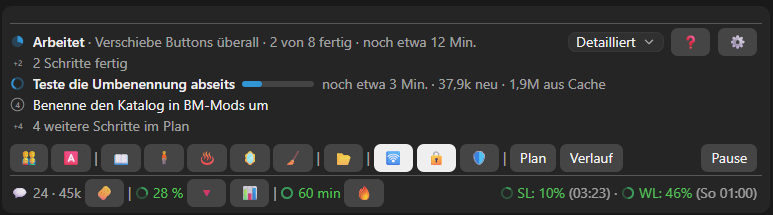
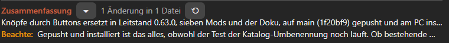
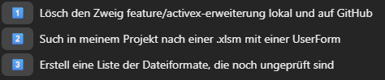
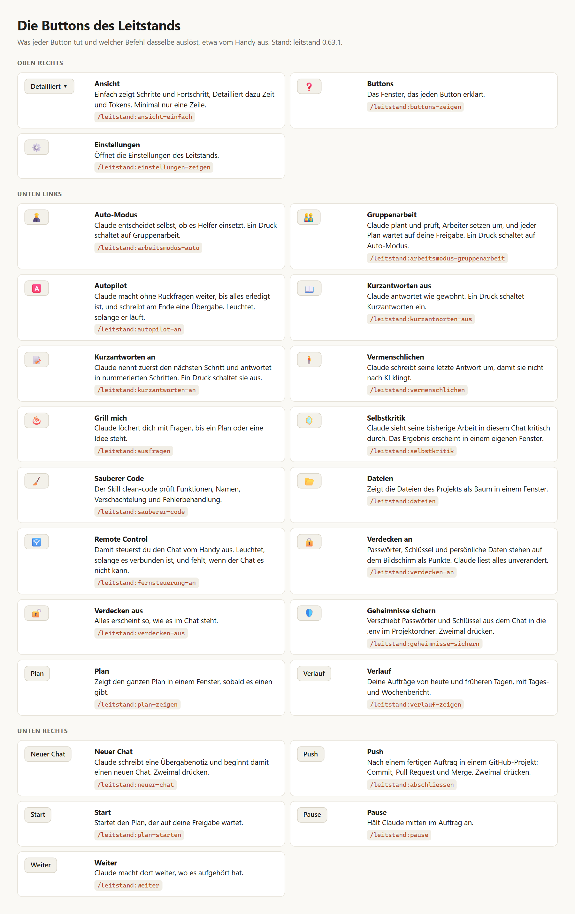
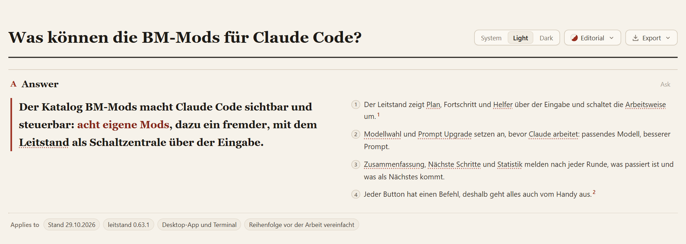
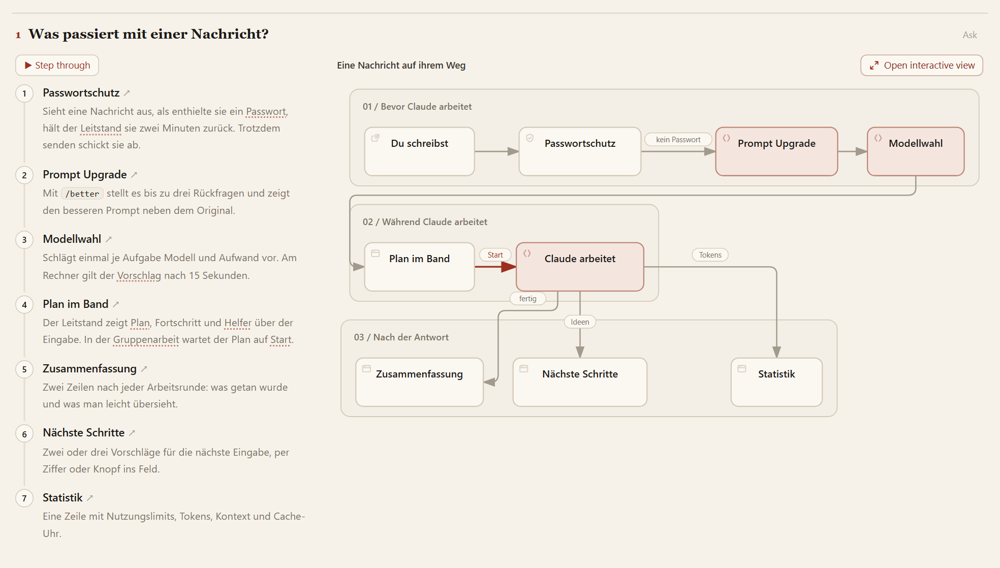
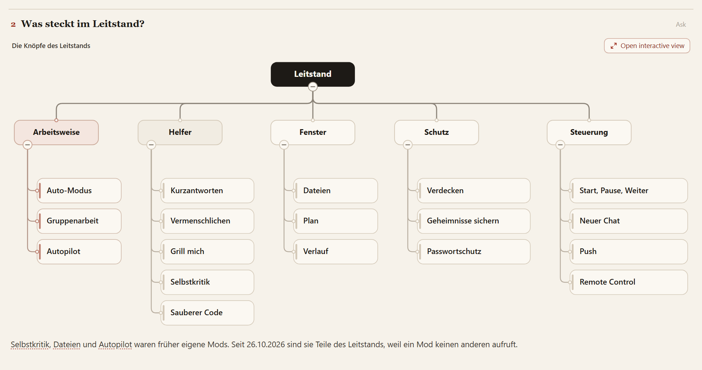
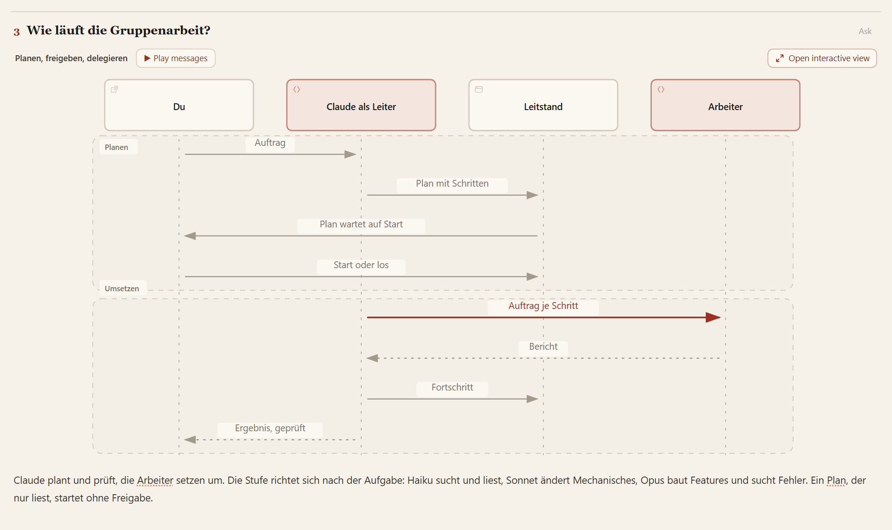

# BM-Mods

Claude-Code-Marktplatz `bm-mods` mit Björns eigenen Mods, dazu i-have-adhd (das englische Original von kurzfassen).
Die eigenen Mods und die deutschen Fassungen liegen hier im Repo, i-have-adhd kommt direkt aus seinem Original-Repo.

Einstellungen gelten je Chat: Ein Schalter, den du in einem Chat umlegst, ändert keinen anderen Chat. Neue Chats
starten mit dem Standard aus dem Einstellungsmenü der App (Leitstand, Zusammenfassung, Visible Compact).

Neue Instanz einrichten:

    git clone https://github.com/bmueller77/claude-mods && claude-mods/install.sh

Vorhandene Instanz umstellen (alte Mods raus, aktuelle rein): Prompt in [UMSTIEG.md](UMSTIEG.md).
Umgestellte Instanz auf den neuesten Stand bringen: Prompt in [UPDATE.md](UPDATE.md).

In `commands/` liegen Befehlsdateien für die Desktop-App (`/autopilot`, `/statistik`, `/warmhalten`, `/zusammenfassung`, `/replay`, `/reflect`, `/better`). Nach `~/.claude/commands/` kopiert, kennt die App diese Befehle schon in der ersten Nachricht einer Sitzung.

## Umbenannt am 2026-10-29

Der Katalog hieß bis dahin `bjoern-mods` und heißt jetzt `bm-mods`, angezeigt als BM-Mods. Das Repo bleibt
`bmueller77/claude-mods`. Bestehende Instanzen laufen unter dem alten Namen weiter und bekommen auch so Updates, bis
sie einmal den Umzug am Anfang von [UPDATE.md](UPDATE.md) machen; er nimmt Einstellungen und gespeicherte Daten mit.
Neu eingerichtete Instanzen tragen den Katalog gleich als `bm-mods` ein. `install.sh` bricht ab, solange noch
`bjoern-mods` eingetragen ist.

## So sieht es aus

Der Leitstand über der Eingabe der Desktop-App: Plan und Fortschritt, darunter die Buttons, ganz unten die Zeile der
Statistik mit Nutzungslimits, Kontext und Cache-Uhr.

Nach jeder Arbeitsrunde sagt die Zusammenfassung in zwei Zeilen, was getan wurde und was man leicht übersieht:

Nächste Schritte schlägt nach jeder Antwort Eingaben vor, per Ziffer oder Klick ins Feld:

Was jeder Button des Leitstands tut und welcher Befehl dasselbe auslöst. Das Fenster ❓ ist für einen Screenshot zu
groß, deshalb als Grafik aus [docs/praesentation/buttons.html](docs/praesentation/buttons.html):

<picture>
  <source media="(prefers-color-scheme: dark)" srcset="docs/bilder/buttons-dunkel.png">
  
</picture>

### Übersicht mit Diagrammen

Die folgenden Bilder stammen aus einer Übersichtsseite, gebaut mit [Archify](https://archify.si/):
[docs/praesentation/bm-mods.html](docs/praesentation/bm-mods.html). GitHub zeigt davon nur den Quelltext,
also herunterladen und im Browser öffnen; dort lassen sich die Diagramme anklicken und Schritt für Schritt
durchgehen. Die englischen Buttons in den Bildern ("Ask", "Open interactive view") gehören zu Archify.

<picture>
  <source media="(prefers-color-scheme: dark)" srcset="docs/bilder/uebersicht-dunkel.png">
  
</picture>

Was mit einer Nachricht passiert, vom Passwortschutz bis zur Statistik:

<picture>
  <source media="(prefers-color-scheme: dark)" srcset="docs/bilder/nachricht-dunkel.png">
  
</picture>

Die Buttons des Leitstands, nach Aufgaben geordnet:

<picture>
  <source media="(prefers-color-scheme: dark)" srcset="docs/bilder/leitstand-dunkel.png">
  
</picture>

Gruppenarbeit: Claude plant und prüft, Arbeiter setzen um, und der Plan wartet auf deine Freigabe:

<picture>
  <source media="(prefers-color-scheme: dark)" srcset="docs/bilder/gruppenarbeit-dunkel.png">
  
</picture>

## Befehle für jeden Button

Alle Befehle je Mod, jeder mit einer Zeile Erklärung, stehen in [BEFEHLE.md](BEFEHLE.md).

Alles, was sich per Button schalten oder auslösen lässt, geht auch per Befehl, damit es auch vom Handy aus
geht. Die Namen folgen Anthropics Schreibweise für Befehle eines Plugins, `/<mod>:<funktion>[-<wert>]`, zum
Beispiel `/statistik:warmhalten-aus`, `/leitstand:autopilot-an`, `/leitstand:regel-global 2`,
`/leitstand:arbeitsmodus-gruppenarbeit`. Jeder Mod hat `/<mod>:hilfe` mit allen Befehlen, und jeder Befehl erklärt
sich mit `hilfe` dahinter (`/statistik:warmhalten-aus hilfe`). Jeder Mod bringt die Dateien für diese Befehle in
seinem Ordner `commands/` selbst mit. Der Leitstand hat dazu Kurzformen ohne `leitstand:`, etwa `/pause`,
`/verdecken-an` oder `/kurzantworten-an`; ohne Kurzform bleiben `an`, `aus`, `hilfe` und `vermenschlichen`, weil die
ersten drei allein nicht sagen, welcher Mod gemeint ist, und `/vermenschlichen` der Skill selbst ist. Ein alter Name
wie `/leitstand-pause` oder `/statistik-zeigen` nennt nur noch den neuen. Befehle, die wie ein Doppelklick
etwas Größeres auslösen (`/neuer-chat`, `/abschliessen`, `/geheimnisse-sichern`), wollen ein `ja` dahinter. Die
Grundbefehle (`/leitstand …`, `/better`, `/reflect`, `/autopilot an|aus`, `/statistik`, `/warmhalten`,
`/zusammenfassung`, `/replay`, `/modellwahl`, `/filetree`) gehen weiter. Für sie und die Kurzformen des Leitstands
liegt in `commands/` eine kleine Datei, damit die Desktop-App sie schon in der ersten Nachricht eines Chats kennt.
Mitten in einer Runde wirken sofort die Kurzformen und Grundbefehle (`/pause`, `/autopilot aus`, `/modellwahl nein`);
ob die Langformen mit Doppelpunkt bis zum Rundenende warten, ist ungeprüft.

## Installiert install.sh

| Mod | Quelle | Was er tut | Kostet Tokens |
|---|---|---|---|
| leitstand | hier (hervorgegangen aus GlanceFlow von Antreas-Strb, MIT; Regeln nach reflect-mod von BayramAnnakov/claude-reflect, MIT; Dateien nach data-goblin/claude-code-filetree, MIT) | Leiste über der Eingabe mit Plan als Checkliste, Fortschritt, Helfern, Verlauf, Teambericht; Arbeitsweisen Auto-Modus und Gruppenarbeit (dort startet ein Plan ohne Freigabe, wenn er nur liest oder der Prompt mit „Starte sofort“ beginnt oder endet, und nach 30 s, wenn er aus einer geplanten Aufgabe kommt); Schalter für Kurzantworten, Remote Control, Autopilot, Verdecken; ❓ neben dem Zahnrad erklärt jeden Button (`/leitstand:buttons-zeigen`); Hilfe: `/leitstand:hilfe`. Eingebaut: Selbstkritik 🪞 (Claude sieht die bisherige Arbeit kritisch durch) und Regeln (lernt aus Korrekturen eine Regel für alle Projekte, dieses Projekt oder nur diesen Chat; gefundene Regeln warten im Seitenfenster Regeln), Dateien 📂 (Dateibaum als Seitenfenster mit Git-Status, im Terminal mit `/tui fullscreen`), Autopilot 🅰️ (Claude arbeitet ohne Rückfragen weiter und schreibt am Ende eine Übergabe); `/leitstand`, `/reflect`, `/filetree`, `/autopilot` | ja: Haiku benennt jeden Auftrag, in der Gruppenarbeit laufen Arbeiter-Subagenten; die Regelprüfung ruft Haiku je kurzer Nachricht (je Chat abschaltbar), die Selbstkritik ist ein Fork über den Chat, jede Runde, die der Autopilot anschiebt, kostet wie eine Nachricht |
| statistik | hier (Eigenbau) | eine Leiste mit Chatlänge, Kontext, Cache-Uhr und Nutzungslimits; Hilfe: `/statistik:hilfe`; Warmhalten, Aufräumen mit Sicherungspunkt (`/statistik:chat-aufraeumen`, der Sicherungspunkt mit `/statistik:letzter-stand-zeigen`), Compact, Kontext-Details über `/context` | beim Warmhalten: jeder Ping liest den Kontext aus dem Cache; beim Aufräumen ein Fork für den Sicherungspunkt |
| naechste-schritte | hier (nach next-steps von Hamza Zafar) | nach jeder Antwort zwei oder drei Vorschläge, per Ziffer 1 bis 3 oder Klick auf den Vorschlag ins Feld, jeder Vorschlag ein Button, alle untereinander, `/naechste-schritte:1` bis `:3` schicken sofort ab. Bietet Claude Antworten ausdrücklich an (etwa Antworte "ja"), stehen sie vorn, und ein Klick schickt sie sofort ab; nach einer Ja/Nein-Frage gibt es ebenso Ja und Nein. Hilfe: `/naechste-schritte:hilfe` | ja, ein Haiku-Aufruf je Antwort |
| zusammenfassung | hier (Eigenbau) | nach jeder Arbeitsrunde: was getan wurde und was man leicht übersieht, mit Dateiliste und Replay; Hilfe: `/zusammenfassung:hilfe` | ja, ein Haiku-Aufruf je Arbeitsrunde |
| visible-compact | hier (deutsche Fassung von nvsravank/visible-compact, MIT) | Chat vor und nach `/compact` nebeneinander, Button Übersetzen; `/show-last-compact`; Hilfe: `/visible-compact:hilfe` | nur beim Übersetzen (Haiku) |
| prompt-upgrade | hier (Eigenbau) | `/better <Prompt>`: bis zu drei Rückfragen, dann ein verbesserter Prompt neben dem Original, gesendet erst auf Ausführen; `/better an|aus` fängt am Rechner getippte Prompts ab (je Chat, Standard aus); Hilfe: `/prompt-upgrade:hilfe` | ja: zwei Haiku-Aufrufe je Upgrade |
| modellwahl | hier (Eigenbau) | schlägt einmal je Aufgabe Modell (Haiku, Sonnet, Opus, Fable) und Aufwand vor: automatisch bei der ersten Nachricht eines neuen Chats, sonst per `/modellwahl [Aufgabe]`; am Rechner gilt der Vorschlag nach 15 s (Übernehmen und Nein über der Eingabe), vom Handy erst auf ja oder ok; nennt den geschätzten Limit-Verbrauch eines Wechsels; Hilfe: `/modellwahl:hilfe` | ja: ein Haiku-Aufruf je Wahl; ein Wechsel mitten im Chat liest den Kontext einmal neu |
| kurzfassen | hier (deutsche Fassung von ayghri/i-have-adhd, MIT) | Kurzfassen als Skill: zuerst die nächste Handlung, nummerierte Schritte; im Leitstand Kurzantworten, Button 📖/📝; Hilfe: `/kurzfassen:hilfe` | nur der Skilltext im Kontext, solange der Modus an ist |
| sorgfalt | hier (deutsche Fassung aus obra/superpowers von Jesse Vincent, MIT) | zwei Skills, die von selbst greifen: debuggen (bei einem Fehler erst die Ursache belegen, dann reparieren; nach drei gescheiterten Korrekturen die Annahme infrage stellen) und belegen (frisch ausgeführte Prüfung vor jeder Fertig-Meldung, Arbeiterberichte am Diff nachprüfen); Hilfe: `/sorgfalt:hilfe` | nur die zwei Beschreibungen im Kontext, der Skilltext erst, wenn er greift |
| clean-code | hier (deutsche, erweiterte Fassung von markky21/claude-skills, MIT) | ein Skill, der beim Review und Refactoring von selbst greift: Review-Ablauf mit Tests zuerst, Regeln zu Namen, Funktionen, Klassen, Fehlern, Annahmen, Kommentaren, Tests und Werkzeugen, Schweregrade nach Folgen; Frontend-Regeln (Komponenten, DOM ohne Framework, Sicherheit, Barrierefreiheit, Performance) nur bei Frontend-Code; Hilfe: `/clean-code:hilfe` | nur die Beschreibung im Kontext, der Skilltext (etwa 10.000 Tokens) erst, wenn er greift |
| i-have-adhd | ayghri/i-have-adhd (MIT) | englisches Original von kurzfassen; der Leitstand nutzt es nur, wenn kurzfassen fehlt | nur der Skilltext im Kontext, solange der Modus an ist |
| you-should-know | in Claude Code eingebaut | wird von install.sh eingeschaltet | ja |

## Im Leitstand aufgegangen am 2026-10-26

Ein Mod ruft keinen anderen Mod auf, höchstens Skills. Deshalb sind Reflect, Filetree und Autopilot jetzt Teile des
Leitstands, der ihre Buttons hat, und keine eigenen Mods mehr. Ihre Ordner liegen weiter im Repo, stehen aber nicht mehr
im Katalog. Wo einer noch installiert ist, läuft er neben dem Leitstand doppelt: `claude plugin uninstall
<mod>@bjoern-mods` (bzw. `@bm-mods`). Das löscht seine Einstellungen und bei Reflect die offenen Regelvorschläge; Regeln, die schon in
einer CLAUDE.md stehen, bleiben.

| Alter Mod | Jetzt im Leitstand |
|---|---|
| reflect | Selbstkritik 🪞 (`/selbstkritik`) und Regeln (`/regeln`); `/reflect` geht weiter |
| filetree | Dateien 📂 (`/dateien`); `/filetree` geht weiter |
| autopilot | Autopilot 🅰️ (`/autopilot-an`, `/autopilot-aus`); `/autopilot` geht weiter |

Das Aufräumen mit Sicherungspunkt ist aus demselben Grund vom Leitstand in die Statistik gezogen, die es vorher über
`/leitstand tidy` angestoßen hat.

## Entfernt am 2026-10-18

Diese Mods aus dem Video sind nicht mehr im Katalog. Wo einer noch installiert ist: `claude plugin uninstall <mod>@bjoern-mods`.

| Alter Mod | Ersetzt durch |
|---|---|
| savvy-progress (JohnnyVizz/claude-kit) | leitstand |
| glanceflow (hier, bis 0.44.0) | leitstand (umbenannt) |
| nachtschicht (hier, bis 0.1.1) | autopilot (umbenannt) |
| next-steps (hamzafer/claude-code-mods) | naechste-schritte |
| cache-meter (hier, 0.2.0) | statistik |
| cache-tax (karanb192/cache-tax) | statistik |
| catch-me-up (oliverow/catch-me-up) | zusammenfassung |
| replay-theater (anthropics/claude-code-playground) | zusammenfassung |
| blast-radius (anthropics/claude-code-playground) | nichts; riskante Bash-Befehle werden nicht mehr angehalten |

visible-compact zeigt im Katalog auf die deutsche Fassung hier im Repo statt auf nvsravank/visible-compact.

## Plattformen

Kein Mod läuft nur unter Windows.

- Der Leitstand spielt Töne, Sprache und Desktop-Meldungen unter Windows über PowerShell. Auf dem Mac nimmt es den Player und die Stimme von Claude Code und `osascript` für Meldungen, unter Linux `paplay`, `pw-play` oder `aplay`, dazu `spd-say`, `espeak-ng` oder `espeak` und `notify-send`.
- 🛜 Remote Control gibt es nur in der Claude-Desktop-App.
- Buttons zeichnen die Desktop-App und seit leitstand 0.61.0 auch das Terminal, dort mit einigen anderen Zeichen.

## Updates

    claude plugin marketplace update bm-mods

Danach `claude plugin update <mod>@bm-mods` oder Claude Code neu starten. Steht der Katalog noch als `bjoern-mods`
da, gilt bis zum Umzug der alte Name.
